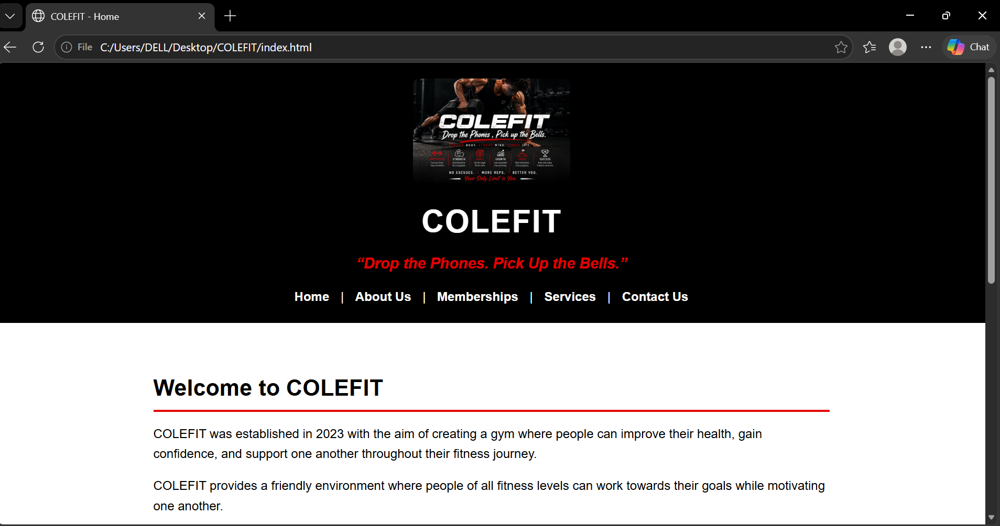
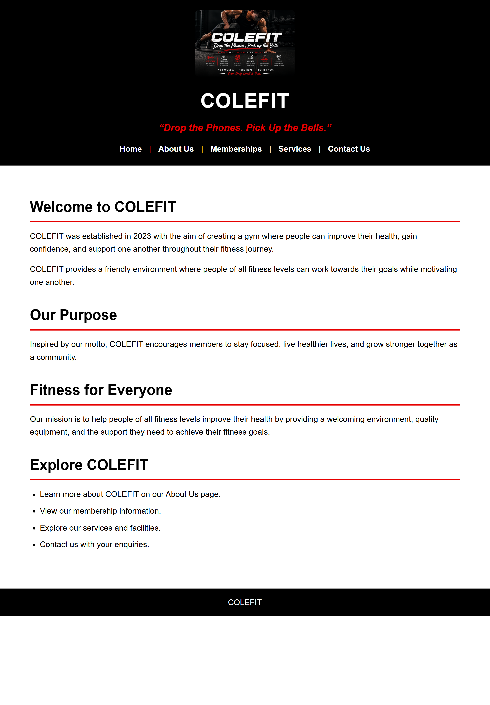
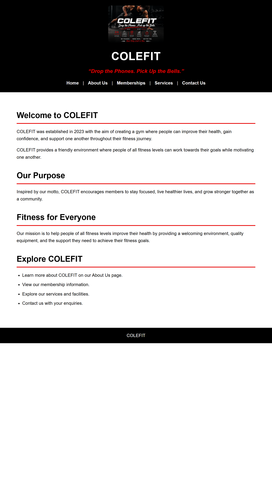

# COLEFIT Website

## Student Information
- **Name:** Cole Liam Stevens
- **Student Number:** ST10545947
- **Module:** WEDE5020 – Web Development (Introduction)
- **Group:** One

## Project Overview
COLEFIT is a gym established in 2023, built around the motto "Drop the Phones. Pick Up the Bells." This website was developed to increase brand awareness, attract new members, and provide visitors with clear information about the gym's memberships, services, and contact details. The site was built using HTML for structure, with CSS styling and responsive design being added in Part 2.

## Website Goals and Objectives
- Increase awareness of the COLEFIT brand.
- Attract new members through online enquiries.
- Encourage new member registrations.
- Drive visitor engagement across the website.

## Key Features and Functionality
- **Home** – Introduces COLEFIT and welcomes visitors.
- **About Us** – Shares the gym's history, mission, vision, and values.
- **Memberships** – Provides membership information.
- **Services** – Displays training programmes and facilities.
- **Contact Us** – Includes contact details, location, operating hours, and an enquiry form.

## Timeline and Milestones
- **Part 1:** Project initiation, planning, and HTML structure – Completed.
- **Part 2:** CSS styling and responsive design – Completed.
- **Part 3:** Functionality and SEO – Completed.

## Sitemap
- index.html (Home)
- about.html (About Us)
- memberships.html (Memberships)
- services.html (Services)
- contact.html (Contact Us)
- thank-you.html (Enquiry confirmation)

## Part 1 Details
Part 1 focused on building the foundation of the COLEFIT website: setting up the file/folder structure, creating the HTML structure for all 5 pages, and linking them together with a functional navigation menu.

## Changelog

### [Date: 11 September 2026]
- Added HTML comments to `index.html`, `about.html`, `memberships.html`, `services.html`, and `contact.html`, explaining the purpose of the header, navigation, main content, and footer sections (and the enquiry form on `contact.html`). This addresses Part 1 feedback, which noted that comments were present but did not sufficiently explain the developed/written code.

### [Date: 29 October 2026] - Part 3: Changes based on Part 2 feedback
- Part 2 feedback showed lost marks in the responsive design criteria: Media Queries/Breakpoints (5/10), and Layout, Typography, Navigation Menu and Images adjustments (2/5 each). The changes below address each one.
- Added `<meta charset="UTF-8">` and `<meta name="viewport" content="width=device-width, initial-scale=1.0">` to the `<head>` of all 5 pages (`index.html`, `about.html`, `memberships.html`, `services.html`, `contact.html`). Without the viewport tag, mobile browsers ignored the media queries and displayed the desktop layout shrunk down.
- Removed the "|" text separators from the navigation menu on all 5 pages. On mobile they were displayed as separate lines between the links.
- Replaced the two original media queries in `style.css` with three breakpoints (1024px, 768px and 480px) so the site adapts gradually between screen sizes.
- Layout: the main content width and padding now reduce at each breakpoint, and the Values and Explore lists stack into a single column on mobile.
- Typography: body text, headings and paragraph sizes now scale down at each breakpoint, not just the header.
- Navigation menu: links wrap and centre on tablet, and stack vertically on mobile with larger tap areas.
- Images: the header image now resizes progressively (200px on desktop, 170px on tablet, 120px on mobile).
## References
Mozilla Developer Network (MDN). (2025). HTML: HyperText Markup Language. Available at: https://developer.mozilla.org/ (Accessed: 4 August 2026).

World Wide Web Consortium (W3C). (2025). HTML Standard. Available at: https://www.w3.org/ (Accessed: 4 August 2026).

xneelo. (2025). Web Hosting Solutions. Available at: https://xneelo.co.za/ (Accessed: 4 August 2026).

ZA Central Registry (ZACR). (2025). Domain Name Registration. Available at: https://www.zacr.co.za/ (Accessed: 4 August 2026).

Virgin Active South Africa. (2026). Virgin Active South Africa. Available at: https://www.virginactive.co.za/ (Accessed: 6 August 2026).

Mozilla Developer Network (MDN). (2025). CSS Flexible Box Layout. Available at: https://developer.mozilla.org/en-US/docs/Web/CSS/CSS_flexible_box_layout (Accessed: 13 September 2026).

Mozilla Developer Network (MDN). (2025). Using Media Queries. Available at: https://developer.mozilla.org/en-US/docs/Web/CSS/CSS_media_queries/Using_media_queries (Accessed: 13 September 2026).

Mozilla Developer Network (MDN). (2025). Pseudo-classes. Available at: https://developer.mozilla.org/en-US/docs/Web/CSS/Pseudo-classes (Accessed: 13 September 2026).

Mozilla Developer Network (MDN). (2026). JavaScript Guide. Available at: https://developer.mozilla.org/en-US/docs/Web/JavaScript/Guide (Accessed: 31 October 2026).

Mozilla Developer Network (MDN). (2026). Intl.DateTimeFormat. Available at: https://developer.mozilla.org/en-US/docs/Web/JavaScript/Reference/Global_Objects/Intl/DateTimeFormat (Accessed: 31 October 2026).

Mozilla Developer Network (MDN). (2026). Client-side form validation. Available at: https://developer.mozilla.org/en-US/docs/Learn/Forms/Form_validation (Accessed: 31 October 2026).

Mozilla Developer Network (MDN). (2026). The Inline Frame element. Available at: https://developer.mozilla.org/en-US/docs/Web/HTML/Element/iframe (Accessed: 31 October 2026).

Mozilla Developer Network (MDN). (2026). Fetch API. Available at: https://developer.mozilla.org/en-US/docs/Web/API/Fetch_API (Accessed: 31 October 2026).

Web3Forms. (2026). Web3Forms: Free contact form API. Available at: https://web3forms.com/ (Accessed: 31 October 2026).

Netlify. (2026). Netlify Docs. Available at: https://docs.netlify.com/ (Accessed: 31 October 2026).

## Live Website
- **Live site (Netlify):** https://colefit-gym-cole.netlify.app/
- **GitHub repository:** https://github.com/coleliamstevens7/COLEFIT-GYM

### [Date: 30–31 October 2026] – Part 3: Enhancing Functionality and SEO
- **Responsive fixes (Part 2 feedback):** Added the viewport meta tag to all pages, removed the "|" separators from the navigation so it stacks correctly on small screens, and added three breakpoints (1024px, 768px and 480px) to `style.css`.
- **SEO:** Gave every page a unique `<title>`, meta description and meta keywords. Renamed all images with descriptive file names (for example `colefit-reception-desk.jpg`) and wrote descriptive alt text for each image.
- **JavaScript file:** Created `script.js` in the project root and linked it to the pages that use it.
- **Accordion (services.html):** Added accordion sections that open and close when clicked, using `aria-expanded` so the state is available to assistive technology.
- **Search (services.html):** Added a search box that filters the accordion sections as the visitor types and shows how many results were found.
- **Gallery lightbox (about.html):** Added a gallery whose pictures open in a large overlay with close, previous and next buttons, plus Escape and arrow-key controls.
- **Interactive map (contact.html):** Embedded a Google Map of the Sandton area and added an "Open in Google Maps" link for phones.
- **Dynamic content (contact.html):** Added a message that shows whether COLEFIT is open or closed right now, using South African time and the Operating Hours.
- **Enquiry form (contact.html):** Rebuilt the form with name, email, phone, enquiry type, message and consent fields. Added JavaScript validation with a clear error message for each field.
- **Form processing:** The form is sent in the background with the Fetch API to Web3Forms, which emails each enquiry to the COLEFIT inbox. The visitor is then taken to the new `thank-you.html` confirmation page. Netlify's built-in email notifications were not used because they are not on the free plan.
- **Styles:** Added styles to `style.css` for the accordion, map, gallery, lightbox, search box, open status message and form error messages.
- **Deployment:** Deployed the website on Netlify from the GitHub repository and tested all pages and the enquiry form on the live site.
- **Version control:** Committed each change to GitHub with a descriptive commit message.

## Responsive Design Screenshots

### Desktop View

### Tablet View

### Mobile View

### [Date: 12 September 2026]
- Created external stylesheet (style.css) and linked it to all 5 HTML pages.
- Applied base styles including a CSS reset, Aptos font, and the black/white/red colour scheme.
- Styled header, navigation, main content, and footer sections.
- Styled the enquiry form on contact.html.
- Implemented responsive design using media queries for tablet and mobile screens.
- Added screenshot evidence of desktop, tablet, and mobile views to the README.